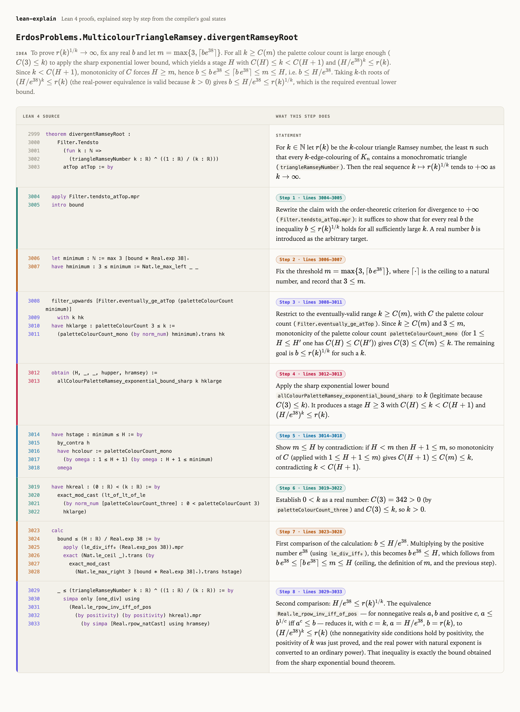

# lean-explain

Step-by-step natural-language explanations of Lean 4 proofs, grounded in the goal states
the Lean compiler reports at each tactic.


The screenshot is unedited output for `exists_isUniform_of_rdist_eq_zero` in
[teorth/pfr](https://github.com/teorth/pfr), generated with `deepseek-v4-1-flash-1017-ultrafast`.

## What it does

Large formal proofs are now being published faster than anyone can read them, and many of
them are machine-written. lean-explain takes a declaration in a Lean project and produces
an English account of what its proof actually does, for a mathematician who does not read
Lean.

1. **Extract.** It builds the module, runs the Lean REPL over it, and records every tactic
   with the goal state before it, plus the project lemmas and definitions each proof uses.
2. **Plan.** It walks the dependency graph from the target. Project lemmas within `--depth`
   are explained first; everything deeper is cited by its Lean statement.
3. **Explain.** A model explains each lemma bottom-up from that record. Each lemma's English
   statement and notation are passed to the lemmas that use it, so no request needs the
   whole proof and long proofs are split at tactic boundaries.
4. **Check.** Every step must cite the source lines it covers. Steps that cite lines outside
   the proof, or lines with no tactic, are flagged mechanically.
5. **Score.** For projects with a [blueprint](https://github.com/PatrickMassot/leanblueprint),
   a judge model compares each explanation with the human-written statement and proof.

The generator never sees docstrings or the blueprint, so it cannot paraphrase the informal
proof instead of explaining the formal one.

## Results so far

### Against a human-written blueprint

Two modules of [teorth/pfr](https://github.com/teorth/pfr) and one of
[fpvandoorn/carleson](https://github.com/fpvandoorn/carleson) have been evaluated against
their blueprints, generated with `deepseek-v4-1-flash-1017-ultrafast` and judged by
`gemini-4-carbon`. A blueprint result is scored once, over all the Lean declarations that
formalize it.

| Module | Results judged | Statement equivalent | Proof steps covered | With an error flagged | Steps citing valid lines |
|---|---|---|---|---|---|
| `PFR.HundredPercent` | 4 | 4 | 100% | 1 | 100% |
| `PFR.ForMathlib.Entropy.RuzsaDist` | 15 of 16 | 14 | 94% | 3 | 100% |
| `Carleson.ForestOperator.AlmostOrthogonality` | 4 | 3 | 92% | 3 | 100% |
| The same Carleson module, with `--review` | 4 | 4 | 100% | 1 | 100% |

The judge has not been calibrated against human labels, so these are not benchmark
numbers. What the second module showed:

- The flagged errors are mostly sentences where the explainer added a justification the
  proof does not contain, and got it wrong. Telling the generator to report what an
  automated tactic closed, instead of supplying a reason, reduced them but did not remove
  them.
- The one statement judged different is a real gap between the formalization and the
  blueprint: the Lean lemmas drop a characteristic 2 hypothesis and prove only the
  inequalities, where the blueprint also states two equalities.
- On Carleson the first run left a named constant unexpanded, misnamed a project object,
  and reversed "smaller" and "larger". The second Carleson row adds three changes at once:
  cited definitions keep their doc comments, the prompt asks for a constant's formula, and
  `--review` has the model check its draft against the record. It is one run of four
  results, so it does not show which change helped or that the gain is stable.
- The rows were produced at different prompt versions, so they are not comparable with
  each other.

### On a machine-written proof



[openai/ten-proofs](https://github.com/openai/ten-proofs) has no blueprint to score
against, so these are reading checks, not judged results.

| File | Size | Declarations | Tactics | Extraction | Explained | Time | Cost |
|---|---|---|---|---|---|---|---|
| `MulticolorTriangleRamsey.lean` | 126 KB | 152 | 1,480 | under 2 min | `erdos_183`, 11 lemmas | 46 s | $0.32 |
| `CompactnessAndDegeneracy.lean` | 722 KB | 981 | 8,296 | 4 min 45 s | `not_erdos_146`, 16 lemmas | 63 s | $0.44 |
| `GapCVP.lean` | 5.3 MB | 8,606 | 30,042 | 20 min 31 s | `finitePNormGapCVPIsNPHard`, 10 lemmas | 40 s | $0.25 |

In the first file, three lemmas and the four definitions they rest on were checked line by
line against the Lean and matched. In the second, the top-level argument was checked
against the Lean, and one 150-tactic lemma was explained in three parts to exercise the
long-proof path: its 17 steps cover all 159 proof lines in source order.

In the third, the main theorem is a one-line term-mode application of a private transfer
lemma. Its statement, the transfer lemma's three steps, and the five definitions they
paraphrase (the gap factor $n^{1/(200p)}$, well-formedness, the yes and no conditions, the
reduction structure) were checked against the Lean and matched. Two levels deep is still
plumbing here: the hardness argument itself sits further down among 8,606 declarations
and has not been explained.

Machine-written proofs lean on case analysis. One ten-line lemma in the second file runs
its closing tactic on 225 goals, so a tactic that ran on many goals is shown to the model
for its first two with the total count.

### Cost

On Venice, explaining and judging the 24 declarations of the Ruzsa distance module cost
$2.04: $1.18 for the generator and $0.86 for the judge. `--budget` caps a run, and a capped
run keeps its finished results and resumes from cache.

## Usage

Requires [uv](https://docs.astral.sh/uv/) and [elan](https://github.com/leanprover/elan).

```sh
# Clone a Lean project, fetch its Mathlib cache, and build the REPL for its toolchain.
uv run lean-explain fetch https://github.com/teorth/pfr

REPL=workspace/repl-v4.36.0-rc2/.lake/build/bin/repl

# List a module's declarations, tactic counts, and project dependencies. No model needed.
uv run lean-explain extract --project workspace/pfr --repl $REPL --module PFR.HundredPercent

# Explain a theorem and the project lemmas it uses directly.
uv run lean-explain explain --project workspace/pfr --repl $REPL \
  --module PFR.HundredPercent --decl exists_isUniform_of_rdist_eq_zero --depth 1

# Explain every blueprint-tagged theorem in a module and score it with a judge model.
uv run lean-explain eval --project workspace/pfr --repl $REPL \
  --module PFR.HundredPercent --blueprint workspace/pfr/blueprint/src/chapter/100_percent.tex
```

`--review` adds a second request per lemma in which the model checks its draft against the
tactic record and corrects it; it roughly doubles the generator cost.

`explain` writes Markdown, a side-by-side HTML page, a JSON sidecar, and `pairs.jsonl`
(one Lean and English pair per lemma) to `out/<model>/`. `--dry-run` prints the plan and
stops before calling the model.

### Models

Any OpenAI-compatible chat completions endpoint works. With `VENICE_API_KEY` in
`.env.local` the tool uses [Venice](https://venice.ai); see `.env.example` for other
endpoints. A local server needs no key:

```sh
uv run lean-explain explain ... --base-url http://127.0.0.1:8080/v1 --model inkling-2-mini \
  --max-chars 20000
```

`--max-chars` bounds the tactic record sent per request, for models with small context
windows.

## Help wanted

The design and evaluation plan are in [docs/design.md](docs/design.md). Open problems,
roughly in order of value:

- **Judge calibration.** Hand-label 20 to 50 explanations and measure how often the judge
  agrees, before any score here is trusted.
- **More reference data.** Run the evaluation over the rest of the PFR and Carleson
  blueprints and other blueprint projects (PNT+, FLT, sphere eversion), and find where the
  explainer breaks.
- **Ablations.** Measure what the review pass and each prompt rule contribute, over enough
  results and repeated runs to separate signal from model variance.
- **Machine-written proofs at scale.** The motivating target is
  [openai/math](https://github.com/openai/math), a 474 MB library. Nothing from it has
  been run yet, and Lean identifiers coined by the prover still leak into statements.
- **Term-mode proofs.** Proofs without tactics have no goal states to ground against.
- **Model comparison.** Which models explain Lean faithfully, and at what cost, is unmeasured.

Issues and pull requests are welcome.

## Development

```sh
make ci   # ruff and pytest
```

## License

MIT. See [LICENSE](LICENSE).
