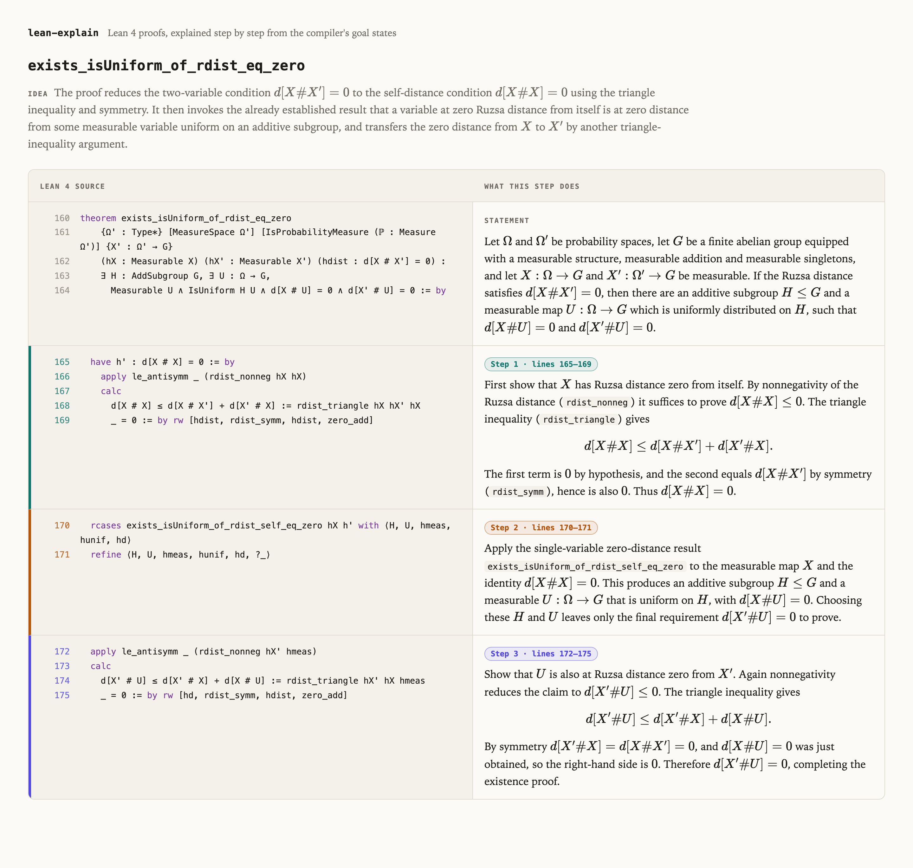

# lean-explain

Step-by-step natural-language explanations of Lean 4 proofs, grounded in the goal states
the Lean compiler reports at each tactic.



The screenshot is unedited output for `exists_isUniform_of_rdist_eq_zero` in
[teorth/pfr](https://github.com/teorth/pfr), generated with `deepseek-v4-1-flash-1017-ultrafast`.

## What it does

Large formal proofs are now being published faster than anyone can read them, and many of
them are machine-written. lean-explain takes a declaration in a Lean project and produces
an English account of what its proof actually does, for a mathematician who does not read
Lean.

1. **Extract.** It builds the module, runs the Lean REPL over it, and records every tactic
   with the goal state before it, plus the project lemmas and definitions each proof uses.
2. **Plan.** It walks the dependency graph from the target. Project lemmas within `--depth`
   are explained first; everything deeper is cited by its Lean statement.
3. **Explain.** A model explains each lemma bottom-up from that record. Each lemma's English
   statement and notation are passed to the lemmas that use it, so no request needs the
   whole proof and long proofs are split at tactic boundaries.
4. **Check.** Every step must cite the source lines it covers. Steps that cite lines outside
   the proof, or lines with no tactic, are flagged mechanically.
5. **Score.** For projects with a [blueprint](https://github.com/PatrickMassot/leanblueprint),
   a judge model compares each explanation with the human-written statement and proof.

The generator never sees docstrings or the blueprint, so it cannot paraphrase the informal
proof instead of explaining the formal one.

## Results so far

One blueprint chapter has been evaluated: the four theorems of `PFR.HundredPercent`,
generated with `deepseek-v4-1-flash-1017-ultrafast` and judged by `gemini-4-carbon`.

| Metric | Result |
|---|---|
| Statement equivalent to the blueprint | 4 of 4 |
| Blueprint proof steps found in the explanation | 100% |
| Steps citing valid source lines | 100% |
| Explanations with a mathematical error flagged | 1 of 4 |

This is a small, easy sample, and the judge has not been calibrated against human labels,
so read it as evidence that the pipeline works end to end and not as a benchmark. The
flagged error is an imprecise sentence in a summary whose corresponding step is correct.

## Usage

Requires [uv](https://docs.astral.sh/uv/) and [elan](https://github.com/leanprover/elan).

```sh
# Clone a Lean project, fetch its Mathlib cache, and build the REPL for its toolchain.
uv run lean-explain fetch https://github.com/teorth/pfr

REPL=workspace/repl-v4.36.0-rc2/.lake/build/bin/repl

# List a module's declarations, tactic counts, and project dependencies. No model needed.
uv run lean-explain extract --project workspace/pfr --repl $REPL --module PFR.HundredPercent

# Explain a theorem and the project lemmas it uses directly.
uv run lean-explain explain --project workspace/pfr --repl $REPL \
  --module PFR.HundredPercent --decl exists_isUniform_of_rdist_eq_zero --depth 1

# Explain every blueprint-tagged theorem in a module and score it with a judge model.
uv run lean-explain eval --project workspace/pfr --repl $REPL \
  --module PFR.HundredPercent --blueprint workspace/pfr/blueprint/src/chapter/100_percent.tex
```

`explain` writes Markdown, a side-by-side HTML page, a JSON sidecar, and `pairs.jsonl`
(one Lean and English pair per lemma) to `out/<model>/`. `--dry-run` prints the plan and
stops before calling the model.

### Models

Any OpenAI-compatible chat completions endpoint works. With `VENICE_API_KEY` in
`.env.local` the tool uses [Venice](https://venice.ai); see `.env.example` for other
endpoints. A local server needs no key:

```sh
uv run lean-explain explain ... --base-url http://127.0.0.1:8080/v1 --model inkling-2-mini \
  --max-chars 20000
```

`--max-chars` bounds the tactic record sent per request, for models with small context
windows.

## Help wanted

The design and evaluation plan are in [docs/design.md](docs/design.md). Open problems,
roughly in order of value:

- **Judge calibration.** Hand-label 20 to 50 explanations and measure how often the judge
  agrees, before any score here is trusted.
- **More reference data.** Run the evaluation over the rest of the PFR blueprint and other
  blueprint projects (Carleson, PNT+, FLT), and find where the explainer breaks.
- **Machine-written proofs.** The motivating target is
  [openai/math](https://github.com/openai/math), where single proofs run to megabytes. The
  chunking path is unit-tested but has not been run on a proof that large.
- **Term-mode proofs.** Proofs without tactics have no goal states to ground against.
- **Model comparison.** Which models explain Lean faithfully, and at what cost, is unmeasured.

Issues and pull requests are welcome.

## Development

```sh
make ci   # ruff and pytest
```

## License

MIT. See [LICENSE](LICENSE).
