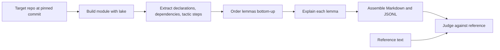

# lean-explain design

Status: proposed, 2026-11-21.

## Intent

lean-explain takes a compiled Lean 4 proof and produces a step-by-step explanation in
English that a mathematically literate reader can follow without reading Lean. The first
targets are the machine-written proofs OpenAI published in `openai/math`, where a single
result can span megabytes of Lean and the only English account is a manuscript that may
argue differently from the formal proof. The explanation must describe what the Lean
actually does, so every claim in it traces back to a tactic and the goal state Lean
reported at that point.

## Goals, non-goals, and anti-goals

The tool explains one named declaration and everything in its own project that the proof
depends on. The output is hierarchical: the theorem stated in English, an outline of the
lemmas it rests on with a paragraph each, and tactic-level detail with goal states for any
lemma the reader opens. Every run also writes its (Lean, English) pairs as JSONL, so the
same pipeline yields evaluation cases now and training data later.

Translating English into Lean, proving anything, fine-tuning a model, and building a UI
are out of scope. Mathlib and other upstream libraries are cited by lemma name and
docstring and are never unfolded.

The failure this design guards against is an explanation that paraphrases the paper
instead of the proof. The generator therefore never sees the reference manuscript; only
the judge does.

## Approaches considered

1. Source only: feed the Lean text to a model and summarize hierarchically. This needs no
   Lean install, but the model has to guess what each `simp` or `grind` call did, so
   step-level claims are unverifiable.
2. Compiler-grounded: build the proof, extract the dependency graph and the goal state
   around every tactic, and explain bottom-up from that record.
3. Agentic: give a model a Lean language server and let it explore. This is the least
   code, but runs are non-deterministic, costly per proof, and hard to regression-test.

Approach 2 was chosen because step-by-step claims are only trustworthy when they are
backed by what Lean saw, and because a deterministic extraction stage makes the output
cacheable and testable.

## Pipeline

**Build.** A target is a repository URL, a commit, and a declaration name. The tool
clones the repository, installs the toolchain it pins through `elan`, fetches the Mathlib
build cache, and builds only the module containing the declaration, because `openai/math`
is one 474 MB library whose README advises against compiling it whole.

**Extract.** Extraction runs `leanprover-community/repl` at the tag matching the target's
toolchain, with `allTactics` enabled. For each declaration it records the statement, the
source span, and for each tactic the text, position, goals before it, and constants used.
The dependency graph is the set of constants each proof uses, restricted to the target's
own modules. Goals after a tactic are taken from the goals before its successor. The
result is one JSON file per module, and it is the only input the later stages read.

**Explain.** Lemmas are processed in topological order. A leaf lemma is explained from
its statement and tactic steps alone; a lemma that uses others also receives their
one-paragraph summaries, so the explanation of a large proof never needs the whole proof
in context. Runs of bookkeeping tactics are grouped into a single step. A tactic block
too long for one request is split at tactic boundaries and summarized in sequence. Each
explained step carries the source span it describes. Explanations are cached by a hash of
the extracted record and the prompt version, so a rerun pays only for what changed.

**Assemble.** The output for a target is one Markdown file plus a JSON sidecar holding
the same content with spans, which is what the judge and the JSONL export read.

The orchestrator is Python 3.12 managed with `uv`. The model is Claude through the
Anthropic API, with the model ID and a per-run spend cap in configuration. The API key is
read from `.env.local` and is never written by the tool.

## Evaluation

Three data sets serve three purposes.

| Set | Source | Reference granularity | Use |
|---|---|---|---|
| Development | Blueprint projects, starting with `teorth/pfr` | Per lemma, through `\lean{}` tags in the blueprint LaTeX | Prompt and pipeline iteration |
| Smoke | `facebookresearch/miniF2F` | Per problem, informal solution | Fast regression check |
| Held-out | `openai/math` | Per main result, 176 papers and about 208 declarations in `lean/formalization.yaml` | Final measurement only |

The `openai/math` manuscripts are dated September and October 2026, so current models
have not been trained on them. They are not gold: the repository calls them raw research
data, and the formal proof may take a different route than the paper.

Three scores are reported per target. Statement fidelity asks a judge model whether the
English statement of the theorem matches the reference statement. Step coverage is the
fraction of the reference proof's steps that the judge finds in the explanation, and is
only computed on the development set, where references are per lemma. Grounding is
mechanical: the share of explained steps whose cited span exists in the extraction
record. Before the judge is trusted, its verdicts are compared with 20 hand-labelled
items.

## Constraints

Each target pins its own Lean version (`openai/math` uses v4.34.1, `teorth/pfr`
v4.36.0-rc2), so toolchains and Mathlib caches are per target and take several GB each.
Proof files reach 5 MB, so no stage may assume a file fits in one model request.
Upstream repositories are Apache-2.0 or MIT; the tool clones them at run time and does
not vendor their content.

## Milestones

1. One short PFR lemma goes from repository URL to Markdown.
2. One PFR blueprint chapter is explained and scored on all three metrics.
3. The smallest main result in `openai/math` is explained and scored.
4. Batch runs over the held-out set with the spend cap enforced.

## Left to the builder

The prompt wording, the rule for grouping bookkeeping tactics, the chunk size, the JSON
schema details, and the judge rubric are implementation decisions. Whether the REPL's
`allTactics` output is sufficient at v4.34.1 is unverified and is the first thing
milestone 1 tests.
